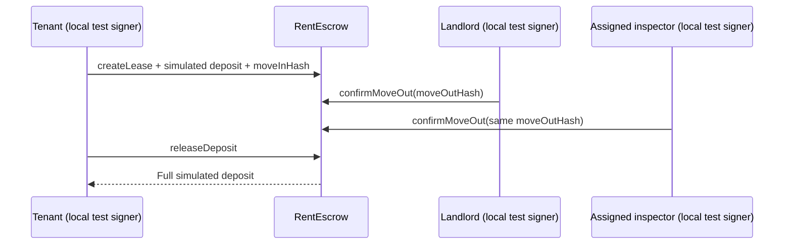

Educational project for the course Introduction to Finance. Not a real product, service or investment offer. Do not use with real funds.

# SmartRent KZ

A hypothetical B2B permissioned blockchain platform for protecting residential and
commercial rental deposits in Kazakhstan. This repository implements its core escrow
workflow on the **local, in-process Hardhat Network only**. Hyperledger Besu is the
proposed consortium platform; this repository does not run Besu or test its consensus.
No real users, property records, funds, tokens or commercial activity are involved.

**Demo video:** https://drive.google.com/drive/folders/19XC4oX3ICpqjLHH-2GjYNXR1EflY4EWG?usp=sharing

Replace that placeholder with the recorded video's shareable Google Drive link.
Repository URL: replace with your team's GitHub repository URL after pushing.
No public testnet or mainnet was used, so there is no testnet contract address.

## What the prototype demonstrates

- A tenant locks a simulated native-ETH deposit with a SHA-256 move-in report hash.
- The landlord and the assigned inspector confirm the same move-out report hash.
- The tenant calls `releaseDeposit` to receive the full deposit under fixed rules.
- A tenant or landlord may open a dispute. Only the inspector selected when that
  lease was created may split its deposit, with an exact sum and a report hash.
- If the landlord takes no action by the deadline, the tenant can trigger a refund.
- The admin can pause, unpause and grant inspector roles; it cannot transfer deposits.

"Automatic" describes deterministic contract settlement **after a transaction**.
Contracts do not wake up at deadlines or execute without someone submitting a call.

## Files

```text
contracts/RentEscrow.sol             Core escrow
contracts/LocalAdminMultisig.sol      Local 2-of-3 admin demonstration
contracts/test/PayoutProbe.sol       Test-only payout/reentrancy receiver
scripts/demo.js                     Narrated demonstration
test/RentEscrow.test.js              Exactly six Mocha test cases
hardhat.config.js                   Local-only network and pinned compiler
package.json / package-lock.json    Exact direct versions and dependency lock
.nvmrc / .gitignore                  Runtime selection and excluded files
LICENSE / THIRD_PARTY_NOTICES.md     MIT licence and OpenZeppelin attribution
GIT_COMMIT_PLAN.md                   Three-account contribution instructions
docs/test-output.txt                Captured passing test output
docs/demo-output.txt                Captured demonstration output
```

## Local setup, tests and demo

Use **Node.js 22.16.0 and its bundled npm** (`nvm install` and `nvm use` if nvm is
already installed). No wallet setup, credentials, RPC URL or `.env` is needed.
Only Hardhat's generated default signers are used. Do not print their private keys.

For the downloaded or cloned repository:

```sh
cd smartrent-kz
node --version
npm ci
npx hardhat compile
npx hardhat test
npx hardhat run scripts/demo.js
```

For initialising an empty folder from the supplied source files:

```sh
mkdir smartrent-kz
cd smartrent-kz
npm init -y
mkdir -p contracts/test scripts test docs
# Copy every supplied source/configuration/documentation file into this folder,
# replacing the generated package.json with the supplied package.json.
npm install --save-dev --save-exact hardhat@2.28.0 @nomicfoundation/hardhat-toolbox@6.1.0 @openzeppelin/contracts@5.0.2 ethers@6.16.0 chai@4.5.0 solc@0.8.20
npx hardhat compile
npx hardhat test
npx hardhat run scripts/demo.js
```

Commit the generated `package-lock.json` and use `npm ci` on teammates' machines.
The compiler is pinned to Solidity **0.8.20**; all Solidity files use `^0.8.20`.
The config uses the installed `solc` package rather than downloading a compiler.
After dependency installation, compilation, tests and demo need no external network.
Hardhat 2 is deliberately pinned to support the requested CommonJS configuration
and `@nomicfoundation/hardhat-toolbox`; do not replace it with Hardhat 3 here.
Ethers is v6 throughout. Other named networks are rejected by the configuration.
Each test/demo command starts a fresh ephemeral local chain; no node server is needed.

## Tests and recorded output

The suite contains exactly six `it` cases, with multiple security assertions inside:

1. Deployment and Role Assignment (Admin & Inspector roles).
2. Creating a Lease and Locking Deposit with moveInHash.
3. Happy Path - Move-Out Confirmation and Automatic Deposit Release.
4. Dispute Resolution and Deposit Split by Inspector.
5. Automatic Refund to Tenant After Deadline Timeout.
6. Security & Access Control (unauthorized callers and paused-state actions revert).

See [the complete captured test output](docs/test-output.txt) for a real run ending
in `6 passing`. Execution times and terminal colours vary between machines; they
are not fixed expected values. Compilation messages appear on the first run only.
The tests verify exact balance changes excluding transaction gas, isolated lease
accounting, matching hashes, repeat-settlement prevention, valid split boundaries,
two-owner admin approval, all six paused core entry points, a rejected payout
rolling back settlement, and an attempted callback reentrancy failing.

## Roles and admin restrictions

| Actor | Allowed state-changing actions |
| --- | --- |
| Tenant | Create its lease; dispute; release or time out its own deposit |
| Landlord | Confirm no damage or dispute its lease before/equal to the deadline |
| Assigned inspector | Confirm the same move-out hash; resolve that lease's dispute |
| DEFAULT_ADMIN_ROLE | Pause, unpause, grant INSPECTOR_ROLE only |

Any approved inspector other than the one pinned to the lease is rejected.
Tenant, landlord and inspector must be distinct addresses. The admin-wallet address
cannot be a tenant, landlord or inspector. There is no deposit sweep, arbitrary
withdrawal, upgrade mechanism or admin settlement override. Inherited `grantRole`
is restricted to inspector grants; inherited `revokeRole` and `renounceRole` revert.
Additional admins cannot be granted. Public read-only methods remain available.

The deployed demo admin is an actual **local 2-of-3** contract with three distinct
default Hardhat signers. One owner submits a zero-value call, two different owners
confirm its unique proposal ID, and an owner executes it. Execution is marked before
the external call; completed proposals cannot be replayed. It has fixed owners and
no delegatecall. It is a minimal educational wallet, **not an audited production
multisig**. `RentEscrow` accepts a designated admin address; threshold enforcement
comes from the deployed wallet, not from `AccessControl` itself.

## State machine and deadlines

Lease IDs start at 1. Status values are `None=0`, `Active=1`, `Disputed=2`,
`Released=3`, `Resolved=4`, `Refunded=5`. Only Active leases may be confirmed,
released, disputed or timed out. Only Disputed leases may be resolved.

The landlord may confirm or dispute at `block.timestamp <= deadline`. Afterwards,
new landlord action is rejected, preventing it from racing the tenant's timeout.
The timeout requires `block.timestamp > deadline`, an Active lease, and **no
landlord confirmation**. An inspector-only confirmation does not block timeout.
A timely dispute blocks timeout; arbitration remains necessary. A timely landlord
confirmation blocks timeout; the assigned inspector can complete confirmation later.
Once both have confirmed no damage, opening a dispute is blocked.

Settlements use Checks-Effects-Interactions: terminal status, zeroed deposit,
accounting update and event all precede payment calls, with `nonReentrant` on all
three payout entry points. If either recipient rejects a payment, the entire
transaction rolls back, including any earlier payment in that transaction.
`totalLocked` tracks outstanding deposits; forced native ETH may make the raw
contract balance larger. There is deliberately no admin function to withdraw it.



## Consensus and security

The proposed Besu consortium design uses **IBFT 2.0**, a proof-of-authority protocol
with known validators and immediate finality. Byzantine fault tolerance requires at
least four validators; block creation requires a validator supermajority. Validator
unavailability can halt the network. It does not require public staking. Ethereum
proof of stake instead uses economically staked validators on a public network.
Permissioned membership fits the hypothetical B2B setting but introduces consortium
governance and collusion risks. Current Besu documentation recommends **QBFT for new
private networks**; IBFT 2.0 is discussed here to meet the requested comparison.
This Hardhat prototype verifies EVM application behavior, not validator fault tolerance.
Gas still measures execution; private-network gas pricing is a separate configuration
choice, not an inherent promise of zero fees.

| Threat | Mitigation demonstrated | Remaining limitation |
| --- | --- | --- |
| Reentrancy or double payout | CEI, OpenZeppelin nonReentrant, terminal states, callback test | No external audit |
| Broken access control | Per-lease participant checks; pinned inspector; restricted role API | Colluding participants can still give false attestations |
| One admin key lost/stolen | Two distinct approvals out of three; no deposit withdrawal power | Two compromised owners can pause/grant; two lost owners block admin use |
| Altered report or inconsistent approval | Nonzero SHA-256 digests; identical move-out hash required | Hashes prove consistency, not report truth |
| Late landlord blocking refund | Deadline checks on landlord confirmation/dispute | An on-time dispute requires inspector action |
| Recipient refusing ETH | Revert and preserve the original lease/deposit | A permanently rejecting receiver cannot settle here |

Inspector grants, owner membership and the admin address are intentionally not
revocable/rotatable in this constrained prototype. Lost inspector access can freeze
a disputed lease or an on-time landlord-confirmed lease. Pausing also suspends
refunds. Recovery, appeals, pause governance, inspector replacement, a reviewed
multisig and an independent external security audit would need a separate design
before any hypothetical production deployment. No audit has been performed or
commissioned, and no audit cost quotation is claimed by this repository.

## Privacy, simulation and video recording

Only `bytes32` report digests are submitted: `ethers.sha256(ethers.toUtf8Bytes(...))`
over invented off-chain report bytes. `ethers.id("INSPECTOR_ROLE")` is only the
Keccak-256 role identifier, never a substitute for SHA-256 inspection hashing.
Accounts are anonymous default test signers. Report text, names, identity numbers,
phone numbers, property locations and photos are absent from code and test data.
The required EVM participant addresses are local test-account identifiers, not
real-person or property data. No university branding is used in the prototype.
Hashes and events are visible to network readers: permissioning is not encryption,
and a hash of guessable real data would not guarantee anonymity.

The demo displays **1 simulated ETH = 100,000 synthetic KZT** purely as an invented
UI convention. There is no market exchange rate, KZT movement, payment integration,
stablecoin, token issuance or real asset. Simulated gas explains balance differences.

Suggested recording of at most three minutes:

- 0:00-0:20: show this educational notice and the local-only configuration.
- 0:20-1:50: run `npx hardhat run scripts/demo.js`; narrate its numbered steps.
- 1:50-2:40: run `npx hardhat test`; show all six cases passing.
- 2:40-3:00: explain hash-only evidence and admin restrictions.

Never display private keys, seed phrases, `.env` contents or personal information.
Record the actual commands; a terminal transcript is not a substitute for the video.
Team account attribution belongs in Git history; follow [GIT_COMMIT_PLAN.md](GIT_COMMIT_PLAN.md).

## Licence, technical references and AI disclosure

Original prototype files use the MIT licence in [LICENSE](LICENSE). OpenZeppelin
Contracts **v5.0.2** supplies `AccessControl`, `ReentrancyGuard` and `Pausable` under
MIT; its full upstream notice is preserved in [THIRD_PARTY_NOTICES.md](THIRD_PARTY_NOTICES.md).
Dependencies retain their own licences; see the installed packages.

- [OpenZeppelin access control](https://docs.openzeppelin.com/contracts/5.x/access-control)
- [OpenZeppelin security utilities](https://docs.openzeppelin.com/contracts/5.x/api/utils)
- [OpenZeppelin v5.0.2 MIT licence](https://github.com/OpenZeppelin/openzeppelin-contracts/blob/v5.0.2/LICENSE)
- [Hardhat 2 Toolbox documentation](https://v2.hardhat.org/hardhat-runner/plugins/nomicfoundation-hardhat-toolbox)
- [Besu IBFT 2.0 and current QBFT recommendation](https://docs.besu-eth.org/private-networks/how-to/configure/consensus/ibft)
- [Besu proof-of-authority properties](https://docs.besu-eth.org/private-networks/concepts/poa)

Technical documentation accessed November 13, 2026. These sources explain the
prototype; this repository does not provide a legal or financial assessment.

**AI disclosure:**Gemini  only for grammer and checking code.
